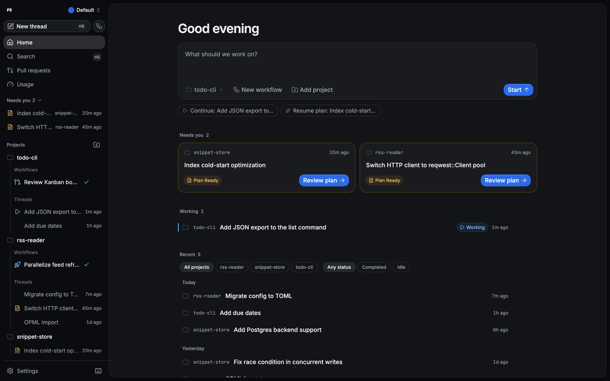
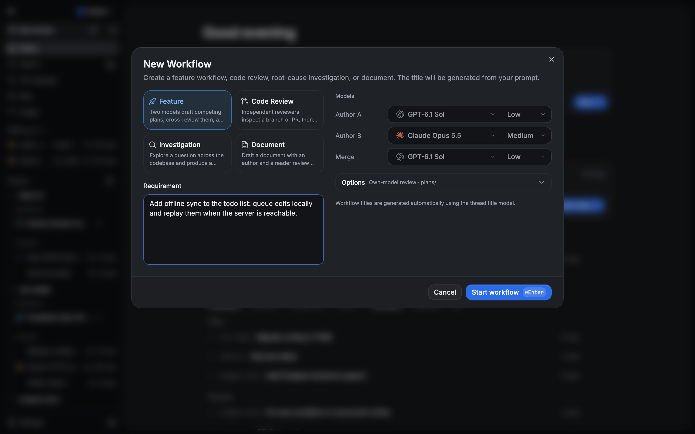
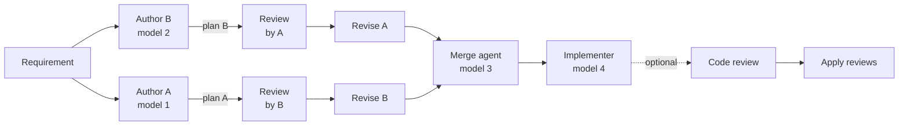
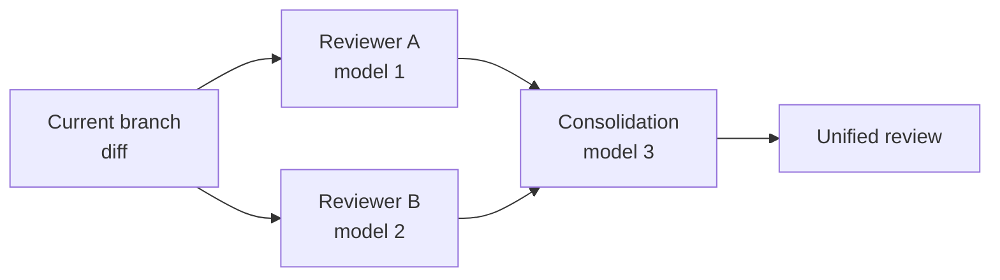
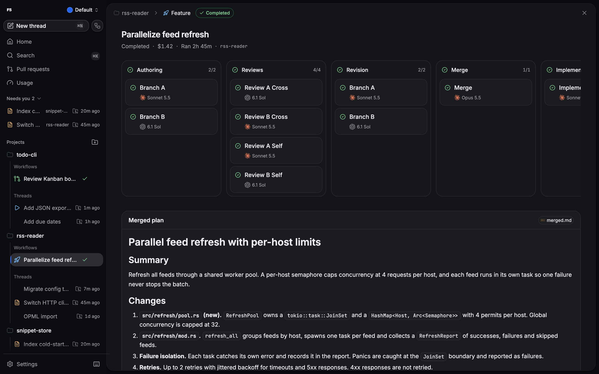
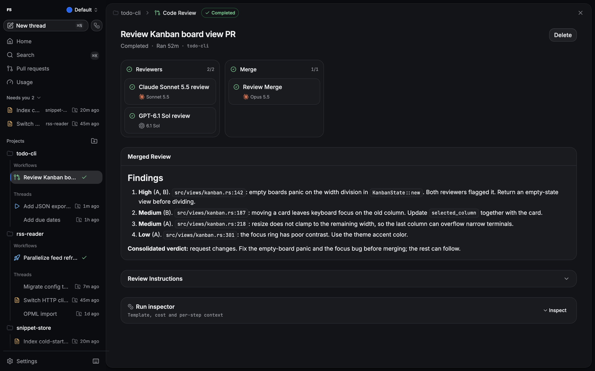

<p align="center">
  
</p>

<h1 align="center">F5</h1>

<p align="center">
  A desktop and web workspace for coding agents, where each step of a workflow can run on a different provider and model.
</p>

F5 runs Codex, Claude Code, Cursor, OpenCode, Grok, Antigravity and Muse Code against your repositories, and chains them into multi-model workflows: competing plans, cross-reviews, merges, implementation and code review, with every step on the provider and model you pick.

Around the workflows sits a chat workspace with diffs, terminals, worktrees, a pull-request hub and usage tracking. F5 is for developers who already use one of these agents and want them working side by side.

> [!WARNING]
> This project is very early. Expect bugs, breaking changes and rough edges. These docs track the current source checkout, so the latest packaged release may lag behind them.


<p align="center">
  
</p>

<p align="center"><em>Home: what needs you, what is running, and recent work across projects.</em></p>

## Highlights

- **[Multi-model workflows](#multi-model-workflows):** Feature, Code Review, Investigation and Document runs with a provider, model and effort per slot.
- **[Seven providers](#providers):** Codex, Claude Code, Cursor, OpenCode, Grok, Antigravity and Muse Code, with several instances per provider.
- **[Four permission modes](./docs/runtime-modes.md):** Supervised, Auto-accept edits, Auto and Full access, chosen per thread.
- **[Thread workspace](#the-thread-workspace):** composer, next-turn queue, diffs, checkpoints, files, terminals and worktrees.
- **[Pull Requests hub](./docs/user/pr-hub-forges.md):** GitHub, GitLab, Bitbucket, Azure DevOps and Forgejo in one place.
- **[Usage and limits](./docs/user/usage-limits.md):** recorded activity, account allowances and cost estimates.
- **[MCP and agent tools](./docs/user/agent-tools.md):** MCP servers, skills, memory and the Agents panel.
- **[Profiles](./docs/profiles.md):** separate F5 profiles with their own state and provider accounts.

## Multi-model workflows

Each slot in a workflow picks its own provider, model and reasoning effort. Start one with **New workflow** in the sidebar or on Home, or press `Mod+Shift+N`.

<p align="center">
  
</p>

<p align="center"><em>Pick a type, describe the work, and choose a model for every slot.</em></p>

| Type          | What happens                                                                                                                                                                                | Slots                                             |
| ------------- | ------------------------------------------------------------------------------------------------------------------------------------------------------------------------------------------- | ------------------------------------------------- |
| Feature       | Two models draft competing plans, cross-review them, and merge the best of both. Implementation is an explicit action after you review the merged plan, optionally followed by code review. | Author A, Author B, Merge, Implementer, Reviewers |
| Code Review   | Independent reviewers inspect a branch or PR, then the findings are consolidated.                                                                                                           | Reviewer A, Reviewer B, Consolidation             |
| Investigation | Two investigators explore a question across the codebase, cross-review each other, optionally review their own work, and a synthesis step writes the answer.                                | Investigator A, Investigator B, Synthesis         |
| Document      | Two authors draft, review and revise, then a merge produces one document with an optional reader review. Types: RFC, one-pager, ADR, PRD, runbook, postmortem, explainer or custom.         | Author A, Author B, Merge, Reader                 |

Document authors and Investigation investigators must use different provider and model pairs. Options cover own-model review, the plans directory, a compare branch and a run cost limit. When you implement a Feature plan, you choose the implementation model, local checkout or a new worktree, the access mode and optional code review.





<p align="center">
  
</p>

<p align="center"><em>A finished Feature run: phases, models and the merged plan.</em></p>

<p align="center">
  
</p>

<p align="center"><em>Two reviewers on different models, one consolidated report.</em></p>

More detail, including retries and stage threads: [workflows guide](./docs/user/workflows.md).

## Providers

| Provider    | How F5 runs it                                     | Sign in                           | Notes            |
| ----------- | -------------------------------------------------- | --------------------------------- | ---------------- |
| Codex       | `codex app-server` (needs `codex` on `PATH`)       | `codex login`                     | Default provider |
| Claude Code | Bundled Claude Agent SDK runtime                   | `claude auth login`               |                  |
| Cursor      | `agent acp`                                        | `agent login`                     | Early Access     |
| OpenCode    | Local `opencode` server, or an external server URL | OpenCode's own provider setup     |                  |
| Grok        | Grok CLI over ACP                                  | `grok login`                      | Early Access     |
| Antigravity | Pinned runtime installed from Settings             | Google sign-in in Settings        | Off by default   |
| Muse Code   | `muse serve` via `@muse-code/sdk`                  | `muse auth set` or `META_API_KEY` | Early Access     |

Capabilities such as permission modes, Plan mode, rewind and browser tools vary by provider and model; see [runtime modes](./docs/runtime-modes.md). You can run several instances of one provider, for example two Codex accounts, from **Settings → Providers**. Isolated [profiles](./docs/profiles.md) support only Codex and Claude Code; the other providers run in the default profile. Setup details: [provider prerequisites](./docs/provider-prerequisites.md).

## The thread workspace

<p align="center">
  
</p>

<p align="center"><em>A thread with its recorded file changes open in the Diff panel.</em></p>

Agents edit the workspace you select for the thread, and you inspect their changes in F5.

- **Composer:** model, traits and access chips, an Agent/Plan switch, a context ring, attachments, skills and `@` file mentions.
- **Next-turn queue:** line up upcoming turns, then pause, reorder or run one now. The queue survives restarts.
- **Changes:** inline diffs, the Diff panel, checkpoints and rewind where the provider supports it.
- **Panels:** Files (with editing), Agents, Plan and Terminal, plus project scripts.
- **Git:** branches, worktrees with setup progress, and pull-request helpers.
- **Tools:** MCP servers (stdio, SSE, streamable HTTP, OAuth), project skills and memory.

Guides: [threads and workspaces](./docs/user/threads-and-workspaces.md) and [agent tools](./docs/user/agent-tools.md).

## Beyond the chat

- **Pull Requests hub** for GitHub and GitHub Enterprise, GitLab, Bitbucket, Azure DevOps and Forgejo: [PR hub guide](./docs/user/pr-hub-forges.md).
- **Usage dashboard** with recorded activity and account limits: [usage guide](./docs/user/usage-limits.md).
- **Profiles** that keep state and provider accounts apart: [profiles](./docs/profiles.md).
- **Preview browser** and the opt-in, uncertified macOS computer use preview: [preview browser](./docs/user/preview-browser.md) and [agent browser](./docs/agent-browser.md).
- **Agent Bridge and Bots** for external clients that reach F5: [Agent Bridge](./docs/agent-bridge.md).
- **Themes, fonts and keybindings:** [keybindings](./KEYBINDINGS.md).
- **Remote access and the standalone CLI:** [remote](./REMOTE.md) and [standalone CLI](./docs/user/standalone-cli.md).

## Download

[Download F5](https://github.com/lopes-felipe/f5/releases/latest). No Node or Bun runtime is needed.

- Windows: run the per-user x64 installer, then open F5 from the Start menu. Windows x64 is the first stable desktop platform, with in-app updates.
- macOS: no stable release yet. Apple Silicon has an unsigned computer use preview.
- Linux: no desktop build yet.
- The `f5` CLI ships for every platform; see the [standalone CLI](./docs/user/standalone-cli.md).

See [installation and preview upgrade instructions](docs/install.md). Check for updates in Settings → About.

First use:

1. Install and open F5.
2. Set up a provider under **Settings → Providers**.
3. Add a project.
4. Start a new thread and pick its provider, model and workspace.
5. Send a request, or open **New workflow**.

Desktop builds bundle their backend. Bun and Node are only needed to build from source.

## Prerequisites

- [Bun](https://bun.sh/) ≥ 1.3.9 and [Node.js](https://nodejs.org/) ≥ 24.13.1, for source builds only.
- At least one signed-in provider. See [`docs/provider-prerequisites.md`](./docs/provider-prerequisites.md).
- Git, for branches, worktrees and diffs.

## Building from source

```bash
bun install --frozen-lockfile
bun run build:desktop
bun run start:desktop
```

Desktop builds target macOS (arm64/x64), Linux (x64), and Windows 11 (x64).

Full source-build recipes: [`docs/quick-start.md`](./docs/quick-start.md).

When updating an existing source checkout, refresh dependencies before starting:

```bash
git pull --ff-only
bun install --frozen-lockfile
bun run start:desktop
```

`start:desktop` rebuilds the app. Desktop builds check for missing dependencies
before starting and print the install command if the local installation is incomplete.

## Configuration

F5 stores persistent state under `~/.f5` by default (`%USERPROFILE%\.f5` on Windows). Prefer `F5_HOME` and `F5_STATE_DIR` for overrides. The inherited `T3CODE_*` variables remain supported for backwards compatibility; see [`NOTICE.md`](./NOTICE.md). Full reference: [`docs/environment.md`](./docs/environment.md).

## Documentation

Start at the [documentation index](./docs/README.md). Common entry points:

- [Install](./docs/install.md)
- [Provider prerequisites](./docs/provider-prerequisites.md)
- [Runtime modes](./docs/runtime-modes.md)
- [Workflows](./docs/user/workflows.md)
- [Profiles](./docs/profiles.md)
- [Project configuration](./docs/project-configuration.md)
- [Keybindings](./KEYBINDINGS.md)

## Repository layout

```
├── apps/
│   ├── desktop     # Electron app (primary distribution)
│   ├── server      # Node.js server; npm package "t3", binaries f5 and t3
│   ├── web         # React 19 / Vite frontend
│   └── marketing   # Astro marketing site
├── packages/
│   ├── contracts   # Shared Effect-Schema types
│   ├── effect-acp  # Agent Client Protocol client (Effect)
│   └── shared      # Shared runtime utilities
└── scripts/        # Dev runner, build helpers, release tooling
```

See [`ARCHITECTURE.md`](./ARCHITECTURE.md) and [`docs/architecture.md`](./docs/architecture.md) for the runtime event flow, orchestration layers, and provider adapter contract.

## Relationship to upstream

F5 is an opinionated fork of [T3 Code](https://github.com/pingdotgg/t3code) by [@pingdotgg](https://github.com/pingdotgg). It keeps the upstream's MIT license and retains a handful of legacy identifiers (the `t3` npm package, `@t3tools/*` workspace names, `T3CODE_*` environment variables) so existing installations keep working. See [`NOTICE.md`](./NOTICE.md) for the full list and [`CHANGELOG.md`](./CHANGELOG.md) for what F5 adds on top.

## Community

Need help or want to follow along? Join the [Discord](https://discord.gg/jn4EGJjrvv).

## Contributing

We are not actively accepting contributions. Small, focused bug fixes and reliability improvements are most likely to be reviewed. Details in [`CONTRIBUTING.md`](./CONTRIBUTING.md).

## License

[MIT](./LICENSE)
