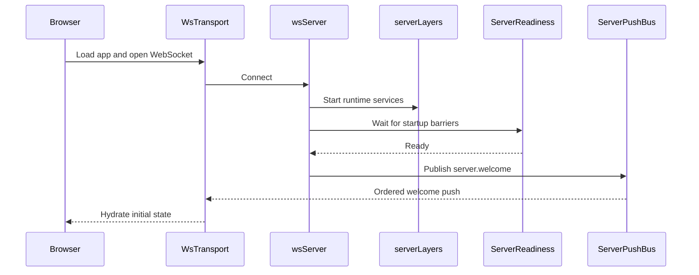
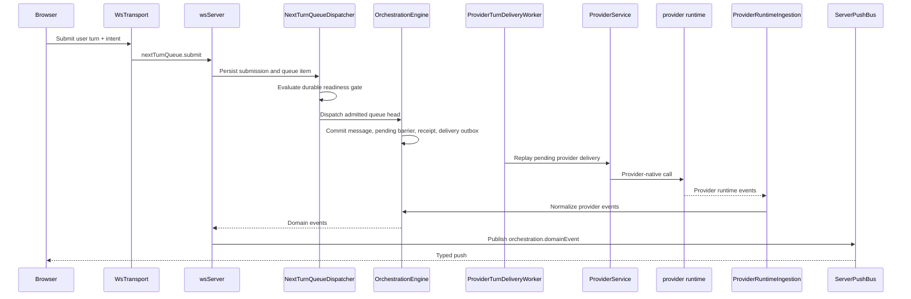
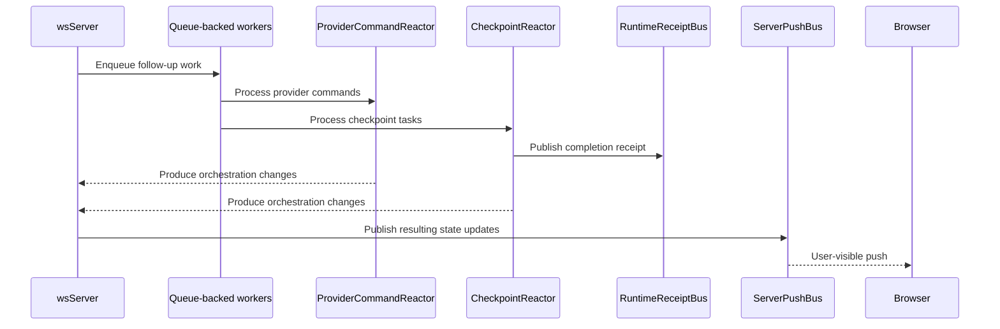

# Architecture

> Contributors: how the server, providers, orchestration and persistence fit together.

F5 runs as a **Node.js WebSocket server** that wraps one or more coding-agent providers and serves a React web app. F5 supports seven providers:

- **Codex** via `codex app-server` (JSON-RPC over stdio).
- **Claude Code** via the `@anthropic-ai/claude-agent-sdk`.
- **Cursor**, **Grok** and **Antigravity** via the Agent Client Protocol (ACP).
- **OpenCode** via its SDK against a local or external OpenCode server.
- **Muse Code** via the Muse Session Protocol (MSP) and `@muse-code/sdk`.

All providers are fronted by a shared `ProviderAdapter` interface so the UI, orchestration, and checkpoint layers stay provider-agnostic.

```
┌─────────────────────────────────┐
│  Browser (React + Vite)         │
│  wsTransport (state machine)    │
│  Typed push decode at boundary  │
└──────────┬──────────────────────┘
           │ ws://localhost:3773
┌──────────▼──────────────────────┐
│  apps/server (Node.js)          │
│  WebSocket + HTTP static server │
│  ServerPushBus (ordered pushes) │
│  ServerReadiness (startup gate) │
│  OrchestrationEngine            │
│  NextTurnQueueDispatcher        │
│  ProviderTurnDeliveryWorker     │
│  ProviderService                │
│  CheckpointReactor              │
│  RuntimeReceiptBus              │
└──────────┬──────────────────────┘
           │ provider-specific transport
┌──────────▼──────────────────────┐
│  provider runtime               │
│  (JSON-RPC, SDK, ACP or MSP)    │
└─────────────────────────────────┘
```

## Components

- **Browser app**: The React app renders session state, owns the client-side WebSocket transport, and treats typed push events as the boundary between server runtime details and UI state.

- **Server**: `apps/server` is the main coordinator. It serves the web app, accepts WebSocket requests, waits for startup readiness before welcoming clients, and sends all outbound pushes through a single ordered push path.

- **Provider runtime**: Each provider process does the actual session work, for example `codex app-server` over JSON-RPC on stdio, a Claude Agent SDK session, an ACP agent process, an OpenCode server or `muse serve`. The server translates their native events into the app's shared orchestration model.

- **Background workers**: Long-running async flows such as runtime ingestion, command reaction, and checkpoint processing run as queue-backed workers. This keeps work ordered, reduces timing races, and gives tests a deterministic way to wait for the system to go idle.

- **Runtime signals**: The server emits lightweight typed receipts when important async milestones finish, such as checkpoint capture, diff finalization, or a turn becoming fully quiescent. Tests and orchestration code wait on these signals instead of polling internal state.

## Event Lifecycle

### Startup and client connect



1. The browser boots [`WsTransport`][1] and registers typed listeners in [`wsNativeApi`][2].
2. The server accepts the connection in [`wsServer`][3] and brings up the runtime graph defined in [`serverLayers`][7].
3. [`ServerReadiness`][4] waits until the key startup barriers are complete.
4. Once the server is ready, [`wsServer`][3] sends `server.welcome` from the contracts in [`ws.ts`][6] through [`ServerPushBus`][5].
5. The browser receives that ordered push through [`WsTransport`][1], and [`wsNativeApi`][2] uses it to seed local client state.

### User turn flow



1. Every established-thread send uses `nextTurnQueue.submit`; the server persists an idempotent submission ledger row and queue item before deciding whether it can start.
2. [`NextTurnQueueDispatcher`][17] serializes admission per thread, checks the SQL readiness barrier, and dispatches at most one queue head for each readiness event. Four stable shards allow unrelated threads to progress independently.
3. [`OrchestrationEngine`][10] atomically commits the user message, pending-turn barrier, command receipt, effective turn settings, and a provider-delivery outbox row.
4. [`ProviderTurnDeliveryWorker`][18] replays the outbox at startup, retries only delivery failures known not to have sent, and surfaces unknown outcomes instead of automatically risking a duplicate turn.
5. [`ProviderService`][8] starts or resumes a session and routes the call through the selected provider adapter. Provider-native events return through [`ProviderRuntimeIngestion`][9].
6. Terminal turns do not release the next queue item until [`CheckpointReactor`][14] durably records processing quiescence. A bounded timeout changes a missing marker into a visible paused state.
7. [`wsServer`][3] pushes orchestration and queue snapshots through [`ServerPushBus`][5]. Queue
   mutations carry monotonic per-thread revisions; clients also accept same-revision snapshots
   when external gate state changes, and invalidate cached thread snapshots on reconnect.

Queue attachments have explicit ingress, queue-item, and message owners. Files are deleted only
after their final owner is removed; storage maintenance exposes ownerless files as a separate,
safe cleanup category.

### Async completion flow



1. Some work continues after the initial request returns, especially in [`ProviderRuntimeIngestion`][9], [`ProviderCommandReactor`][13], and [`CheckpointReactor`][14].
2. These flows run as queue-backed workers using [`DrainableWorker`][16], which helps keep side effects ordered and test synchronization deterministic.
3. When a milestone completes, the server emits a typed receipt on [`RuntimeReceiptBus`][15], such as checkpoint completion or turn quiescence.
4. Tests and orchestration code wait on those receipts instead of polling git state, projections, or timers.
5. Any user-visible state changes produced by that async work still go back through [`wsServer`][3] and [`ServerPushBus`][5].

[1]: ../apps/web/src/wsTransport.ts
[2]: ../apps/web/src/wsNativeApi.ts
[3]: ../apps/server/src/wsServer.ts
[4]: ../apps/server/src/wsServer/readiness.ts
[5]: ../apps/server/src/wsServer/pushBus.ts
[6]: ../packages/contracts/src/ws.ts
[7]: ../apps/server/src/serverLayers.ts
[8]: ../apps/server/src/provider/Layers/ProviderService.ts
[9]: ../apps/server/src/orchestration/Layers/ProviderRuntimeIngestion.ts
[10]: ../apps/server/src/orchestration/Layers/OrchestrationEngine.ts
[11]: ../packages/contracts/src/orchestration.ts
[12]: ../apps/web/src/nativeApi.ts
[13]: ../apps/server/src/orchestration/Layers/ProviderCommandReactor.ts
[14]: ../apps/server/src/orchestration/Layers/CheckpointReactor.ts
[15]: ../apps/server/src/orchestration/Layers/RuntimeReceiptBus.ts
[16]: ../packages/shared/src/DrainableWorker.ts
[17]: ../apps/server/src/nextTurnQueue/Layers/NextTurnQueueDispatcher.ts
[18]: ../apps/server/src/orchestration/Layers/ProviderTurnDeliveryWorker.ts

Profiles isolate environments at the process boundary, with sibling registry/lock storage and separate state directories. See [Profiles](profiles.md).

## Retained orchestration message-content consumers

The read model remains complete. This inventory is the first phase of the proposed
memory redesign; it does not authorize replacing text or truncating decider state.
The realistic fixture must exceed 300 MB after deleted-thread handling before the
second phase starts. The warning above 200,000 retained messages is observability
only, and reports counts/characters without changing retained arrays.

| Consumer                            | Content needed from the engine's retained messages                                                                                                               | Required boundary before slimming                                                                                                                            |
| ----------------------------------- | ---------------------------------------------------------------------------------------------------------------------------------------------------------------- | ------------------------------------------------------------------------------------------------------------------------------------------------------------ |
| `ProviderCommandReactor`            | Text/reasoning/attachment-name character estimates; initial user prompt and title-regeneration context; queued first-send text                                   | Repository-backed context/title reads and incremental character totals, fenced by thread/history revision. Role/turn/id checks can use message metadata.     |
| `ProviderRuntimeIngestion`          | Existing assistant text for duplicate-prefix/suffix recovery and finalization                                                                                    | A repository read tied to the same message/turn/generation before deciding whether a completion adds a suffix.                                               |
| `WorkflowService`                   | Strict proposed-plan wrapper validation from the final assistant message; latest user text/attachments when retrying implementation                              | Read the exact pinned completed message or original request through a repository, preserving operation/turn identity.                                        |
| `SessionNotesService`               | Recent user/assistant text summarized into provider context                                                                                                      | Bounded repository history at an explicit source watermark.                                                                                                  |
| `codexSnapshotReconciliation`       | Existing assistant text to compare native history and avoid duplicate deltas                                                                                     | Repository reads tied to the reconciliation's captured generation/history coverage.                                                                          |
| `rewind`                            | Target user-message text/attachments copied into a recoverable draft                                                                                             | Read the immutable target message inside the fenced rewind operation; preserve draft persistence and attachment ownership.                                   |
| `WorkspaceTransition`               | First user prompt and attachments for branch naming                                                                                                              | Repository-backed first-message lookup before preparation, retaining workspace/root checks.                                                                  |
| `StuckTurnRepair`                   | Nonempty finalized assistant text as one piece of repair evidence                                                                                                | Read the exact final assistant message for the originating turn; a log's partial final line remains insufficient evidence.                                   |
| `wsServer` legacy full-snapshot RPC | Entire message text/reasoning is returned by the legacy read-model response                                                                                      | Serve that response from a consistent repository snapshot before changing the engine representation. Tail/history RPCs already use snapshot readers.         |
| Engine projector and decider        | The projector appends/replaces content and estimates context. Decider message checks include role/id/turn/streaming status, pivot existence and history ordering | Preserve decision equivalence for all message/history commands. Repository fallbacks and retained metadata must exist before replacing content with lengths. |

`CheckpointReactor` needs message IDs/roles/turns for checkpoint association;
`WorktreeSetup` uses message presence. Their current checks do not require full text.
The remaining project/worktree/queue/workflow lifecycle reads use aggregate metadata,
workflow records, sessions, IDs or counts. Re-run the inventory when adding a new
`getReadModel()` consumer: follow helper calls as well as direct `.messages` accesses.
