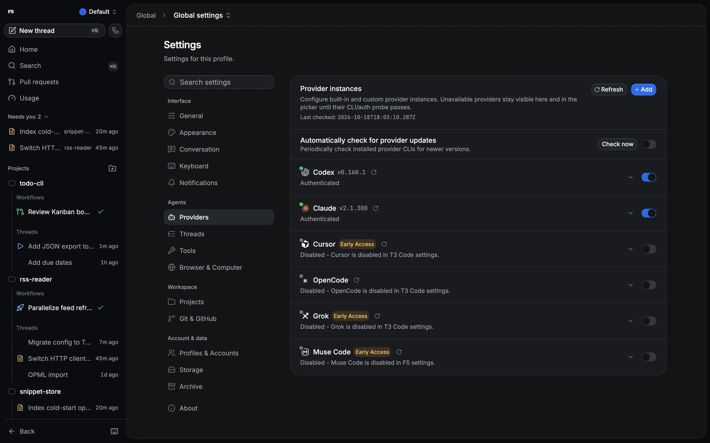

# Provider prerequisites

F5 needs at least one signed-in coding-agent provider on the machine that runs the F5 server.
You pick the provider and model per thread in the composer.

## How to

1. Install Git.
2. Install at least one provider below and sign in once in a terminal.
3. Open **Settings → Providers**, enable the provider, and check that it shows **Authenticated**.
4. If F5 can't find the executable, set **Binary path** on the provider.

Switching providers never needs a server restart. F5 starts a provider session when you first
send a message with it.

## Providers

| Provider    | Install                                                                           | Sign in                                                                                      |
| ----------- | --------------------------------------------------------------------------------- | -------------------------------------------------------------------------------------------- |
| Codex       | [Codex CLI](https://github.com/openai/codex) on your PATH                         | `codex login` (ChatGPT or API key)                                                           |
| Claude Code | Bundled with F5; no global `claude` needed                                        | `claude auth login` from a [Claude Code](https://docs.anthropic.com/en/docs/claude-code) CLI |
| Cursor      | Cursor CLI, so `agent` is on your PATH                                            | `agent login`                                                                                |
| OpenCode    | `opencode` on your PATH, or an external server URL                                | OpenCode's own provider setup                                                                |
| Grok        | Grok CLI, so `grok` is on your PATH                                               | `grok login`                                                                                 |
| Antigravity | **Install Antigravity** in Settings (off by default)                              | **Sign in** with Google in Settings                                                          |
| Muse Code   | `curl -fsSL https://dev.meta.ai/install.sh \| bash` (F5 never runs the installer) | Run `muse`, `muse auth set`, or set `META_API_KEY`                                           |

Cursor, Grok and Muse Code are Early Access. Provider pages: [Codex](providers/codex.md),
[Claude](providers/claude.md), [Antigravity](providers/antigravity.md) and
[Muse Code](providers/muse.md).

## Several accounts

Add several instances of one provider in **Settings → Providers**, for example two Codex accounts
with different homes. Instances share the profile they run in. Isolated F5
[profiles](profiles.md) support only managed Codex and the bundled Claude runtime; other providers
run in the default profile.

## Updating providers

**Check now** in **Settings → Providers** looks for provider updates, even with **Automatically
check for provider updates** off. F5 updates each installation through its own source (npm,
Homebrew or the provider's own updater) and shows a command to copy where it can't. The bundled
Claude runtime updates with F5 itself. Finish or stop active work first: F5 stops idle sessions on
that installation while it updates.

## Good to know

> [!NOTE]
> In-app updates run only from the **Default** profile, on macOS and Linux. Windows and isolated
> profiles show a command to copy instead.

- If `codex` is missing or signed out, starting a session fails with a clear error.
- `META_API_KEY` takes precedence over a stored Muse browser sign-in.
- OpenCode's **Server password** for an external server is stored in plain text on disk.
- On macOS, a quarantined `opencode` download is blocked; fix it with
  `xattr -d com.apple.quarantine $(which opencode)`.

Provider updates in detail

- **npm:** public-registry global installs (including nvm/fnm prefixes) update the exact version
  with npm and Node from that prefix. Custom registries and prefixes F5 can't write to show manual
  guidance or a copy command. Failed registry detection is reported separately and can be retried.
- **Homebrew:** formulas and casks update through the owning Homebrew. Core packages use the
  Homebrew API for versions; other taps use local metadata.
- **Native Claude and OpenCode** use their built-in updaters. Claude keeps its `latest` or `stable`
  channel from the instance's Claude config directory; an unreadable channel needs a manual update.
- **Bundled Claude** shows **Bundled with F5**; **Open F5 updates** opens the app's update
  settings.
- **Manual:** devbox, Bun, Volta, pnpm and custom registries get installation-specific guidance and
  **Refresh and verify**. Remote OpenCode servers update on their host.
- **Safety:** the dialog lists other instances sharing the executable. New starts and turns on it
  are rejected until the update is verified, and only one installation updates at a time.
  Installers get OS, proxy, certificate and package-manager settings, never provider API keys.
- **Verification:** the update continues if you navigate away. F5 re-probes every affected instance
  afterwards and needs a successful probe to confirm the version. Failed output stays on the card
  until dismissed. Results aren't kept as history. Stopping the server kills the installer, and the
  next health probe detects a partial install.
- **Checks:** a rate limit shows when checking can resume; failed checks keep the last known
  version. If the auto-check preference can't be read, scheduling stays off.

Windows executable overrides

F5 starts providers without a command shell, so `cmd.exe` never reinterprets paths or options.
Native `.exe`/`.com` files, JavaScript CLI entry points and standard npm Node `.cmd` shims work.
Other `.bat`, `.ps1` and non-Node `.cmd` wrappers are rejected; point F5 at the wrapped
executable or JavaScript entry point instead.

Custom Claude binary paths are stricter: use a directly runnable executable or the Claude CLI
JavaScript entry point, not a `.cmd` or `.bat` shim. Standard Node installations with a separate
AppData global npm prefix are supported for copied update commands.

## Related

- [Install F5](install.md)
- [Getting started](user/getting-started.md)
- [Runtime modes](runtime-modes.md)
