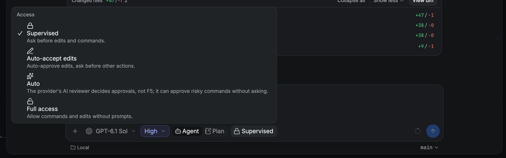

# Runtime modes

A runtime mode is a thread's permission posture: what the agent may do without asking you. You
choose it per thread from the access chip in the composer.

## How to

1. Click the access chip in the composer (it shows the current mode, such as **Supervised**), or
   press `mod+shift+a` on desktop.
2. Pick a mode. New sessions in that thread use it.
3. To change the default for new threads, use **Settings → Threads → Default permissions**, or
   override it per project in [project settings](user/project-settings.md).

## Modes

| Mode                  | What the agent may do                                               |
| --------------------- | ------------------------------------------------------------------- |
| **Supervised**        | Asks before edits and commands                                      |
| **Auto-accept edits** | Edits files freely and asks before other actions                    |
| **Auto**              | The provider's own AI reviewer approves actions, not F5 and not you |
| **Full access**       | Runs commands and edits without prompts. This is the default        |

## Provider support

| Provider    | Supervised | Auto-accept edits | Auto | Full access |
| ----------- | :--------: | :---------------: | :--: | :---------: |
| Codex       |    Yes     |        Yes        | Yes  |     Yes     |
| Claude Code |    Yes     |        Yes        | Yes  |     Yes     |
| OpenCode    |    Yes     |        Yes        |  No  |     Yes     |
| Cursor      |    Yes     |        No         |  No  |     Yes     |
| Grok        |    Yes     |        No         |  No  |     Yes     |
| Antigravity |    Yes     |        No         |  No  |     Yes     |
| Muse Code   |     No     |        Yes        |  No  |     Yes     |

Muse Code approves in-workspace edits in every mode, so F5 never offers Supervised for it. See
[Muse Code](providers/muse.md).

## Good to know

> [!WARNING]
> **Auto** can approve risky commands without asking. Use it only where that is acceptable.

- The mode is saved with the thread, so reconnects and resumes keep it.
- A repository's `f5.json` can set the default mode. Your project override wins over it.
- If F5 can't load the settings for a new draft, it falls back to **Supervised**.

Details and limits

| Mode              | Codex (`approvalPolicy` + `sandbox`)                     | Claude Code (`permissionMode`) |
| ----------------- | -------------------------------------------------------- | ------------------------------ |
| Supervised        | `untrusted` + `read-only`                                | `default`                      |
| Auto-accept edits | `on-request` + `workspace-write`                         | `acceptEdits`                  |
| Auto              | `on-request` + `workspace-write`, reviewer `auto_review` | `auto`                         |
| Full access       | `never` + `danger-full-access`                           | `bypassPermissions`            |

Claude uses `auto` only when the model and CLI support it; otherwise the session falls back to
`default` and F5 asks before actions.

In settings and `f5.json`, the values are `approval-required`, `auto-accept-edits`, `auto` and
`full-access`. See [Provider architecture](provider-architecture.md) for how adapters apply the
mode.

## Related

- [Threads and workspaces](user/threads-and-workspaces.md)
- [Project settings](user/project-settings.md)
- [Agent browser and computer use](user/agent-browser-and-computer-use.md)
