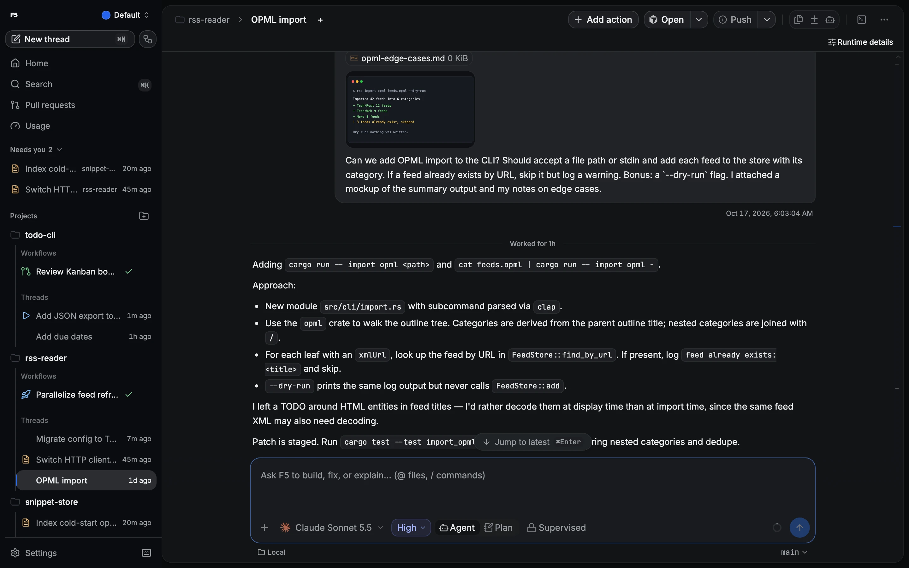
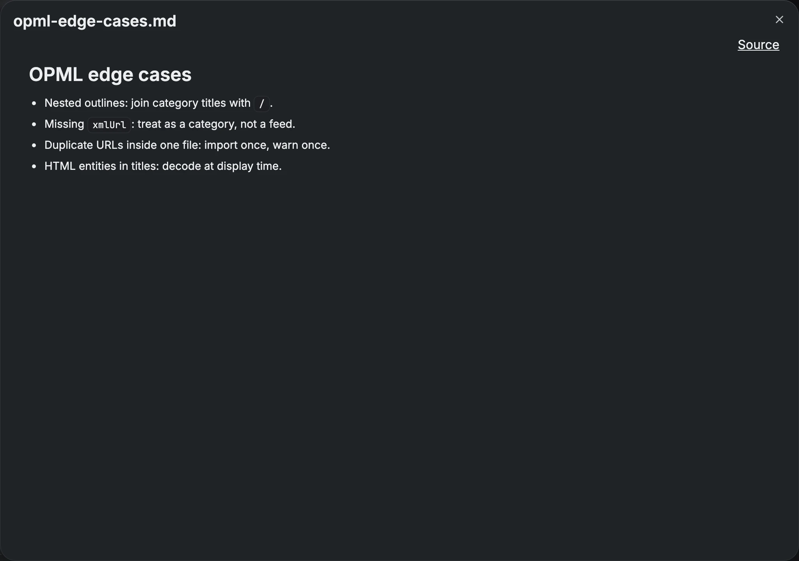

# Attachments and media

Give an agent images, files and folders along with your message. Attachments open in a built-in
viewer, so you can check what you sent.

## How to

1. Click **Attach files**, paste, or drop files onto the composer. You can also drop them onto a
   thread in the sidebar.
2. Watch the upload progress on each chip. Use **Cancel** or **Retry** if needed.
3. Send. F5 waits for uploads to finish before the turn starts.

## Large pastes

A paste of 32 KiB or more, or one longer than the composer allows, becomes a numbered text
attachment instead of filling the composer. On desktop, **Paste as text** (`mod+shift+v`)
pastes it inline.

## View files

Click a chip or file link to open it. The viewer handles images, Markdown, HTML, PDF, video and
audio. Markdown and HTML also have a source view. Images can switch between Fit and Actual size,
and chat images open in a zoomable gallery. Other files can be downloaded, and desktop offers
**Reveal** for workspace files.

## HTML previews

The viewer shows HTML in a sandbox, with scripts, network requests, forms and frames disabled.
**Open in preview browser** runs the page for real on a separate local origin in the desktop
preview.

> [!WARNING]
> Only preview HTML you trust. A previewed page runs its own scripts and can read supported files
> (such as HTML, JS, JSON and images) in its folder and up to five levels below it. For a
> repository-root `index.html`, that includes `package.json` and source files. The page can't
> upload them to another host, but it can navigate to another URL carrying data in the URL.

## Good to know

- Folders are sent as path references, and archives are never extracted.
- Drafts keep upload references, so a failed send leaves the draft intact.
- Remote HTTPS images in chat stay off until you enable **Settings → Conversation → Load remote images
  in chat**.
- An asset URL works like a short-lived password: anyone who has it can read that file until it
  expires. On remote deployments, keep these URLs out of logs and screenshots.

Details and limits

| Limit                     | Value                                        |
| ------------------------- | -------------------------------------------- |
| Attachments per turn      | 100                                          |
| Image / all images        | 10 MiB / 80 MiB                              |
| File                      | 50 MiB                                       |
| All attachments in a turn | 256 MiB (Antigravity: 50 MiB)                |
| Simultaneous uploads      | 2 per client, 4 per server                   |
| Staging quota             | 1 GiB per draft, 2 GiB per profile           |
| Text preview              | First 1 MiB (download keeps the full file)   |
| Asset URL lifetime        | 30 minutes, renewed while the viewer is open |

**Inline images per provider.** Claude, Codex and OpenCode take up to 20 inline images, and
Cursor and Grok up to 10. Extra images are passed as file paths, and F5 shows a notice. OpenCode
receives text and PDF file parts. Other files are described by their saved path, and provider
permissions still decide whether the agent can read it.

**Expiry.** Incomplete uploads expire after 1 hour, and unused finished uploads after 24 hours.
Using a draft renews its uploads for 7 days. An expired draft keeps the file names and asks you to
reattach. Sent messages and queued turns own separate copies that don't expire. Restoring a saved
prompt into another thread makes a separate copy.

**Formats.** HEIC files are kept as ordinary files and are not converted.

**Local media access** is limited to registered projects, their worktrees and this profile's
attachments directory. Previewed pages are limited to scripts, requests, images, frames and form
posts on their own origin, and never receive F5's backend token.

## Related

- [Preview browser](preview-browser.md)
- [Getting started](getting-started.md)
- [Keybindings](../../KEYBINDINGS.md)
