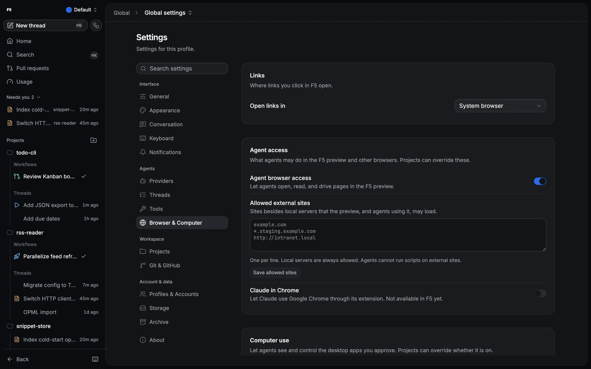

# Preview browser, cookie import and SnapShot

The desktop app has a built-in browser for previewing your work. It has its own profiles, can
import cookies from your normal browser, and SnapShot can grab another app's window into the
composer.

## How to

1. Open **Settings → Browser & Computer**.
2. Create or pick a browser profile. New tabs use the selected profile.
3. Choose where chat links and PR actions open: the preview browser or your system browser.
4. Optionally, import cookies so you are already signed in.

## Browser profiles

Browser profiles are separate from F5 profiles. Persistent profiles survive restarts; incognito
profiles are never written to disk. Each window keeps its own selection, and existing tabs stay on
their profile. Deleting a profile clears its cookies, storage and cache, so close its tabs first.

Tabs have their own zoom, mute and context menu. Sign-in popups open in a small child window that
shares the tab's session. Pages in the preview never get access to F5's API.

## Import cookies

Close the source browser, then pick it and its profile in **Settings → Browser & Computer**. F5 supports
Chromium-family browsers, Firefox and Safari on macOS. Each import goes into a new profile, so
existing profiles are never touched, and **Cancel** discards it. Your source browser's data is
only read, never changed.

## SnapShot (macOS)

Press **Alt+Shift+Command+S** to capture the frontmost non-F5 window. F5 attaches `window.png` and
`window-context.txt` to the current thread's composer. It keeps your draft and never sends a turn.

## Good to know

> [!NOTE]
> SnapShot needs **Screen Recording** access. **Accessibility** access is optional and adds the
> window's text. SnapShot is macOS-only for now.

> [!WARNING]
> Safari import may need **Full Disk Access** for F5 in System Settings. Windows app-bound (`v20`)
> Chromium encryption isn't supported.

- Turning off **Enable agent browser access** (globally or per project) blocks agent automation,
  even for agents already running.
- You'll be asked to confirm before closing tabs an agent opened.
- Remote web sessions always open links in your local system browser.

Details and limits

| Topic                     | Detail                                                                                                                                                                                 |
| ------------------------- | -------------------------------------------------------------------------------------------------------------------------------------------------------------------------------------- |
| Profile registry          | `preview-browser-profiles.json` in the owning F5 profile's state directory; the default browser profile keeps its old partition so existing logins survive upgrades                    |
| Popups                    | OAuth popups open at 520×720 and can't open further popups                                                                                                                             |
| Agent screenshots         | Capped at 2,560 px and 25 MiB encoded                                                                                                                                                  |
| Chromium cookies          | Decrypted with macOS Keychain, Linux `secret-tool`, or Windows DPAPI/AES-GCM                                                                                                           |
| Firefox                   | Containers and partitioned cookies are skipped                                                                                                                                         |
| Import safety             | Source databases are copied to private temp directories and opened read-only; copies are removed. Host-only cookies keep `__Host-` scope. Cookie values never appear in errors or logs |
| Interrupted import        | Abandoned staging profiles are cleared after a restart; retry into a new profile                                                                                                       |
| SnapShot capture          | Window without shadow, downscaled to at most 2,560 px; up to 2,000 accessibility nodes, 3-second timeout, 20,000 characters, from the matching window only                             |
| SnapShot without a thread | Captures wait in memory until you open a thread                                                                                                                                        |

## Related

- [Agent browser and computer use](agent-browser-and-computer-use.md)
- [Attachments and media](attachments-and-media.md)
- [Preview browser release validation](../reviews/preview-browser-release-validation.md) (contributors)
