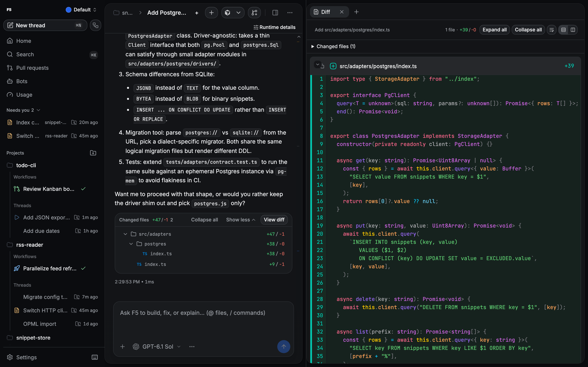

# Threads and workspaces

A thread is one conversation with one agent in one workspace. The agent edits files in the workspace you choose, and F5 records its commands, file changes and plans so you can inspect them afterwards.

  

## Start a thread

Click **New thread** (`Mod+N`) or type in the box on Home. Before you send the first message, pick:

- **Provider and model** from the model chip. Providers come from **Settings → Providers**; see [provider prerequisites](../provider-prerequisites.md).
- **Traits** such as reasoning effort, when the model offers them.
- **Access**, the thread's permission mode. New threads default to Full access; change the default under **Settings → Threads → Default permissions** or per project. See [runtime modes](../runtime-modes.md).
- **Agent or Plan.** Plan asks the agent for a plan you can accept or revise before it changes anything.
- **Workspace:** **Local** works in the project checkout; a worktree gives the thread its own branch and directory. See [worktrees and storage automation](worktrees-and-storage-automation.md).

The composer also takes attachments ([attachments and media](attachments-and-media.md)), `@` file mentions and `/` commands, including skills from your provider and project. The context ring shows how full the model's context window is.

## While the agent works

- **Approvals and questions.** In Supervised and Auto-accept edits modes the agent stops for approval; questions from the agent appear in the thread and wait for your answer.
- **Steer or stop.** Where the provider supports it, a message sent during a running turn can steer that turn instead of waiting. **Settings → Threads → Follow-up behavior** chooses between queueing follow-ups and steering. **Stop generation** ends the turn.
- **Next-turn queue.** Queued messages appear above the composer. You can pause the queue, drag a turn to reorder it or move it to the top, run one now, edit, duplicate or cancel it. The queue is stored on the server, so it survives restarts; a turn that was running during a restart comes back as "Resuming after restart".

## Find your work

- **Home** groups threads into Pinned, Needs you, Working and Recent, with project and status filters on Recent. Pin a thread from its row on Home.
- **Search** (`Mod+K`) finds threads, workflows and commands.
- **Archive** a thread from its sidebar menu. Archived threads and workflows are listed under **Settings → Archive**.
- When a provider reports a usage limit, the notice in the thread can snooze it until a time you pick; snoozed threads show a moon icon.

## Panels

The right side of a thread holds panels. Open them from the panel picker or their shortcuts:

| Panel   | What it shows                                                                    |
| ------- | -------------------------------------------------------------------------------- |
| Agents  | Subagents and background workflows started from the thread.                      |
| Diff    | Files the thread changed, per turn or for a recorded file change.                |
| Plan    | The current implementation plan.                                                 |
| Files   | The workspace file tree and a file viewer with editing.                          |
| Preview | The built-in browser, in desktop builds ([preview browser](preview-browser.md)). |

The integrated terminal (`Mod+J`) opens below the thread in the workspace directory, and project scripts run from the thread header.

### Edit files

The Files panel can edit files directly. Your unsaved draft is kept if you switch away. If the file changes on disk while you have unsaved edits, F5 marks a conflict and keeps your draft instead of overwriting either version, so you can decide what to keep. **Open in editor** hands the file to your external editor.

### Review changes and rewind

Each turn lists its changed files with line counts. **View diff** opens the Diff panel for that turn. F5 records a checkpoint after each turn; on providers that support it, you can revert a thread to an earlier message, which restores the files from that checkpoint. Stop the agent before reverting.

## Git

Threads show their branch. From the thread header you can create branches, open worktrees (setup progress is shown while a worktree is prepared) and run commit, push and pull request actions. Linked pull requests also appear in the [Pull Requests hub](pr-hub-forges.md).

## Thread summaries

F5 can keep short summaries of threads. Under **Settings → Threads → Thread summaries** you choose the provider account and model that writes them. Summaries send thread messages, activities, plans, tasks and checkpoints to that account, including threads that ran on other providers. Pick an account you are comfortable sending that content to.

## Shortcuts

Press `Mod+/` to see all shortcuts, and change them under **Settings → Keyboard**. Defaults and the config file format are in [KEYBINDINGS.md](../../KEYBINDINGS.md).

## Related

- [Project settings](project-settings.md)
- [Agent tools](agent-tools.md)
- [Workflows](workflows.md)
