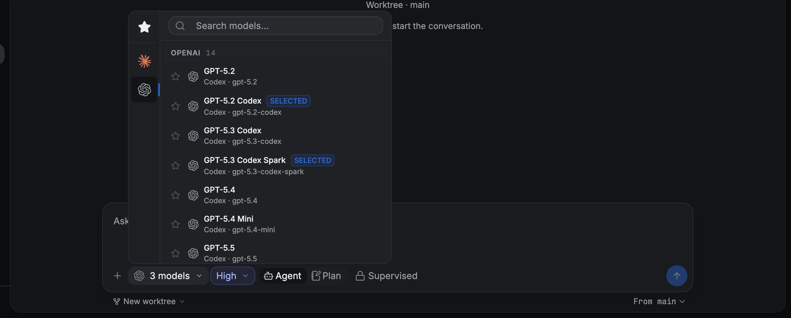
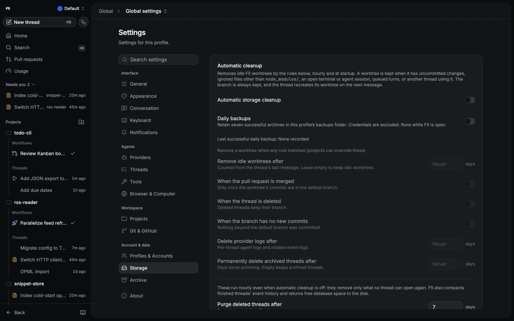

# Worktrees, fan-out and storage automation

Run threads in their own Git worktrees, send one message to several models at once, and let F5
clean up idle worktrees and keep backups.

## How to

1. Start a new thread in a project that is a Git repository.
2. To work in one isolated checkout, switch the workspace under the composer to **Worktree**.
3. To send to several models, Shift+click (or Shift+Enter) up to six models in the model picker
   instead. A plain click goes back to a single model.
4. Send. With several models, F5 creates one thread per model, each with its own worktree and
   branch, whatever the workspace switch says.
5. Follow the setup card above the composer until the agent starts.

## Worktree setup

The first message is queued immediately while F5 prepares the worktree in the background. The
setup card shows each stage: fetching the base branch, checking out files, initializing
submodules, running the project setup script and starting the agent. The message goes out once
checkout and submodules are ready. Setup scripts run in the background unless you enable **Agent
waits**; a failed script is reported on the card and the agent still starts.

From the card you can **Cancel**, **Retry** after a failure, **Work locally** to send the message
in the project root instead, or **Discard** a failed setup to get your message back as a draft.

## Automatic cleanup

**Settings → Storage → Automatic cleanup** (off by default) removes idle worktrees F5 created and
old provider logs. Enable the rules you want: idle for some number of days, PR merged, thread
deleted, or no commits beyond the default branch. **Preview what would run** shows each match and
the action F5 would take or why it would skip it. **Recent activity** shows what ran.

## Removing worktrees and missing checkouts

Deleting conversations opens one removal dialog for their worktrees. Unsafe rows are disabled, and
**Keep all** leaves every checkout in place. Branch deletion is optional and preselected only for
merged branches.

If a thread's worktree goes missing, F5 never quietly moves the thread into the project checkout.
Use **Recreate now** (the branch still exists), **Recreate from the default branch** (it doesn't),
or **Continue in project checkout**. A checkout found on a different branch is kept untouched and
blocked until you restore the branch or choose a recovery action.

## Auto-pull and backups

**Settings → Git & GitHub → Auto-pull default branches** fast-forwards clean project roots with `git pull --ff-only`. It
never merges or rebases. **Export backup** writes a consistent snapshot of settings, threads and
attachments while you keep working. **Daily backups** keeps the seven newest scheduled archives.
Restoring a backup takes effect on restart.

## Good to know

> [!NOTE]
> F5 never removes a worktree that has uncommitted, untracked or ignored files (other than
> `node_modules/`), initialized submodules, an open terminal or provider session, queued turns,
> or an active turn in another conversation using it. Automatic cleanup always keeps the branch,
> so the next message recreates the worktree.

- Cleanup and auto-pull can be set per project, but never from a checked-in `f5.json`.
- If F5 restarts mid-setup, the setup shows as failed and nothing is removed.
- Backups leave out credentials unless you choose encrypted credential export and set a password.
- In a fan-out send, threads that fail to start can be retried from the kept draft.

Details and limits

| Topic               | Detail                                                                                                                                                                                                                                                                                                                                                                                                                       |
| ------------------- | ---------------------------------------------------------------------------------------------------------------------------------------------------------------------------------------------------------------------------------------------------------------------------------------------------------------------------------------------------------------------------------------------------------------------------- |
| Fan-out             | Up to 6 models; threads start 3 at a time; attachments are copied to each thread                                                                                                                                                                                                                                                                                                                                             |
| Cancel during setup | A checkout is removed only if its receipt proves F5 created it, its base commit and files are unchanged and nothing else uses it; generated `.env` files and databases keep it. The message stays queued and paused                                                                                                                                                                                                          |
| Cleanup schedule    | Hourly, at startup, after a thread is deleted and when settings change                                                                                                                                                                                                                                                                                                                                                       |
| Cleanup scope       | Only worktrees inside this profile's worktrees directory; never a directory containing a project root. Unreadable identity, claims, locked registrations and in-progress Git operations also block removal. Idle and archived conversations may stay linked and recreate the checkout on their next send. Checks repeat right before removal, and removal never forces                                                       |
| Provider logs       | Removed after the configured number of days; the live event log is never removed                                                                                                                                                                                                                                                                                                                                             |
| Recent activity     | Kept for 90 days                                                                                                                                                                                                                                                                                                                                                                                                             |
| Preview artifacts   | **Keep preview screenshots and recordings for** defaults to 7 days. Profiles share the folder, so the longest setting wins                                                                                                                                                                                                                                                                                                   |
| Auto-pull           | Every 15 minutes. Needs the default branch checked out with an upstream, a clean tree with no untracked files, no merge/rebase/cherry-pick/revert/bisect, no unpushed commits, and no active conversation, queued work, live agent session or live terminal in the root checkout. Fetches before taking locks, then rechecks and fast-forwards to the inspected commit. Skipped while another profile updates the repository |
| Daily backups       | Checks hourly from 1 minute after launch and exports when no scheduled backup succeeded in 24 hours. Archives go to `<profile state>/backups`. Manual and failed exports don't count. Scheduled backups never include credentials                                                                                                                                                                                            |
| Export              | Runs in a separate process that you can cancel. The SQLite snapshot is integrity-checked. Credential-free exports redact OpenCode passwords and sensitive provider variables                                                                                                                                                                                                                                                 |
| Restore             | Into a different state directory, attachment paths are rebound to the new location; ownership and hashes are kept                                                                                                                                                                                                                                                                                                            |

**Manual removal.** Removal rechecks HEAD and usage under locks, and a changed checkout is kept with
a reason. A fully pushed branch can also be selected for deletion, but a deleted upstream alone
never makes unmerged commits safe. Default branches, branches checked out elsewhere and branches
referenced by other conversations can't be deleted. An open provider session blocks removal, even
between turns; stop it first. Initialized submodules block removal: save their work and
deinitialize them first.

**Recovery.** Recovery stops an idle provider session, applies the project's submodule setting and
starts its opted-in setup script, then releases queued work. Setup preparation has a 10-minute
timeout and a **Cancel preparation** action. A failed or interrupted recovery keeps its retry
controls visible.

**Names and paths.** New worktrees live at
`<repository-slug>-<repository-hash>/<branch-slug>-<branch-hash>` in the profile's worktrees
directory, so `fix/login` and `fix-login` never collide; existing worktrees keep their paths and
occupied targets are rejected. Automatic branch names are generated while the base is fetched; a
name ready within 3 seconds names both branch and directory, and a later one may rename only the
branch. Explicit names must be valid, unused branch names outside F5's temporary-name pattern.
Each model in a multi-model send gets its own allocation.

**Preparation receipts.** F5 records preparation in the profile database before creating a
checkout, so a repeated request reuses its receipt and completed preparation never runs twice.
Recreating a missing checkout initializes submodules and runs the opted-in setup script unless
setup was explicitly skipped; checkouts older than receipts are never prepared again
automatically. A restart during a setup script leaves preparation indeterminate, and **Retry**
asks you to confirm rerunning the script. A changed checkout, repository identity or conflicting
request is kept for inspection.

**Kept on disk.** Cancel and rollback keep checkouts with ignored files created by setup (such as
`.env` or a local database) and report them as retained artifacts. Legacy worktrees with
unresolved Git metadata, and legacy setups without a verified checkout commit, are skipped and
never deleted recursively. Paths are preserved exactly, including whitespace.

## Related

- [Project settings](project-settings.md)
- [Codex marketplace cleanup](../providers/codex.md#good-to-know)
- [Getting started](getting-started.md)
